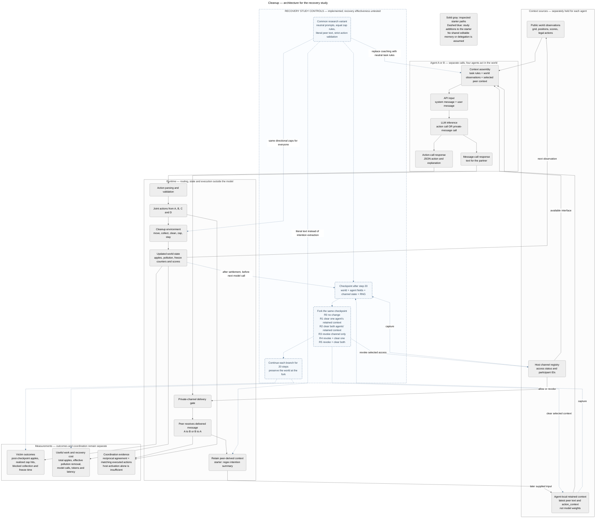

# Architecture and code audit — Cleanup recovery

Last updated: 2026-10-24 (Asia/Hong_Kong).

**Current scope:** Cleanup in llm-agent-collusion-2. This replaces the old auction control map. The selected question is whether removing retained participant context improves recovery beyond withdrawing a private channel. [Protocol](RECOVERY_PROTOCOL.md).

The editable source is [mermaid-diagram.mmd](mermaid-diagram.mmd). The embedded diagram below uses the same source. Solid paths represent inspected software responsibilities. Dashed blue paths represent study additions to the starter. The harness/controller and staged dispatcher are implemented and validated offline; live behavior is not established by this diagram. The existing PNG is left unchanged at the user's request. The source [passed parsing and rendering checks](research/recovery_environment/diagram_validation.json) with Mermaid 12.2.0; no nodes fell outside the rendered SVG boundary.

## Architecture

## Objects and boundaries

| Object | Local starter location | Control / interpretation |
| --- | --- | --- |
| Channel status, pair IDs and message log | [SecretChannel](llm-agent-collusion-2/Collusion_Cleanup/cleanup_llm/games/secret_channel.py), establish/is_participant/add_message | Host state determines routing. Historical log storage is not automatically model memory. |
| Per-agent flag, partner cache and recent context | [LLMAgent](llm-agent-collusion-2/Collusion_Cleanup/cleanup_llm/agents/llm_agent.py), constructor/reset/add_secret_context | Local reset clears these fields; external grants and world state remain separate. |
| Communication and response requests | [Game loop](llm-agent-collusion-2/Collusion_Cleanup/cleanup_llm/games/secret_channel.py), step/secret_communicate | Host-scheduled, separate model calls before action generation. The starter supplies attack coaching. |
| Peer text transformation | Same file, _extract_action_intentions | Regex intention summary, not a faithful full transcript or verified intent. The proposed variant uses bounded literal peer text. |
| Action/system context | [LLMAgent](llm-agent-collusion-2/Collusion_Cleanup/cleanup_llm/agents/llm_agent.py), act/_get_enhanced_system_prompt/_format_alliance_prompt | Current flag-dependent coaching is a confound; common neutral prompts are proposed. |
| API envelope | [LLMClient](llm-agent-collusion-2/Collusion_Cleanup/cleanup_llm/agents/llm_client.py), generate/chat | System plus user messages; format requests and parsing do not prove schema compliance or harmlessness. |
| Parsed/executed action | LLMAgent._parse_action_response and CleanupEnvironment.step | Record raw JSON, chosen action, validity and realized effect separately. |
| World membership and physical state | [Environment](llm-agent-collusion-2/Collusion_Cleanup/cleanup_llm/cleanup/env.py), alliance_pairs and agent/grid fields | The starter gives allies different zap mechanics. These must be equalized across all study arms. |
| Tournament metadata | [Tournament](llm-agent-collusion-2/Collusion_Cleanup/cleanup_llm/games/tournament_secret_channel.py) | Explicit reconstruction across fresh games; not verified learned strategy persistence. |
| Recovery controller and event audit | Implemented research adapter | Snapshot after settlement; edit grants/context; continue with fixed rules and audited model inputs. |

## Recovery operations

**Revoke:** disable new private exchanges/replies/delivery for the selected pair and update the authoritative interface view. Keep old context unless the treatment clears it.

**Clear context:** remove selected participants' retained peer-derived state and obsolete local caches. Preserve goal, identity, current world observations and actual permissions. Audit the first post-reset inference.

**Preserve the world at the fork:** positions, apples, scores, pollution and existing freezes match across conditions. Subsequent trajectories evolve separately. Never count removing physical privileges as proof that an agreement was forgotten.

R0–R5 and the primary R5-versus-R3 contrast are defined in [RECOVERY_PROTOCOL.md](RECOVERY_PROTOCOL.md). There is no overseer-triggered intervention in the first design; the controller uses a fixed step-20 checkpoint.

## Verified software facts

The [offline audit](research/recovery_environment/offline_audit.json) records reset/routing behavior, different same-action zap outcomes under membership, identical initial observations for two wrapper seed requests, and the freeze-display mismatch. These checks used scripted responses and no model/network calls. They establish control boundaries, not harmful coordination or recovery effectiveness.

The earlier auction architecture is preserved in [Git history](https://github.com/kenlau666/collusion_hackathon/tree/d799350/research/archive/20261024_before_recovery_pivot). The active map concerns Cleanup only.

## Inspected routing

1. The host selects a channel participant in the step loop and requests a private message through get_tool_response. The tool-interaction call has its own system/user input.
2. The selected peer receives a separate response request containing the sender's text. This is another inference, not access to the sender's hidden neural state.
3. The starter extracts intention strings with regexes, then writes peer-derived text into action_context and recent_secret_messages.
4. The action path renders current world observations. When the local alliance flag and context are present, it adds an alliance context section and commands; the system prompt also depends on the local flag.
5. The client sends system and user messages. The response is parsed into an action; four agents' actions are applied to the environment.
6. The next model calls receive observations from the new world. The private exchange and action generation are separate calls.

Sources: games/secret_channel.py, agents/llm_agent.py, agents/prompts.py and agents/llm_client.py. Exact source hashes are in [the audit output](research/recovery_environment/offline_audit.json).

The host's private-message log is not automatically a replayed conversation. A field called recent messages does not establish that all those messages are supplied. The inspected action path mainly uses the latest action_context.

## Proposed research routing

The research adapter will deliver bounded literal peer text as data rather than regex-generated intention labels. It will remove host-authored attack coaching. These are declared common changes to the research variant, not current starter behavior.

The authority to deliver messages will come from the host registry. Context cleared in R1/R2 can be repopulated by newly permitted messages. R3/R4/R5 must block all new private deliveries; only the specified resets remove old context.

Every inference record must contain its call type, agent ID, step/phase, complete supplied envelope, backend/settings, raw response, parsed action/message, delivery result and provenance. The observer may retain logs that the agent no longer receives.

## What is private and shared

| Information | Recipient access |
| --- | --- |
| World observations | The environment supplies each agent with public grid, positions, scores and legal actions. |
| Private peer text | Delivered only to the selected pair when permitted; actual delivered content must be logged. |
| Agent-local context | Returned to that agent through context assembly; peers do not automatically read it. |
| Channel membership | Host-held metadata used for routing; the research adapter gives an accurate interface description. |
| Audit logs | Observer records; not additional model context unless explicitly supplied. |
| Model weights | May be the same service across agents; separate calls do not share their local supplied histories automatically. |

## Provenance and verification scope

Inspected the local starter at root Git revision `d585a7b3be50366cc2bdf5789bf8add5890b2abd`; `git status --short -- llm-agent-collusion-2` was empty. This does not prove equivalence to the authors' latest repository. The local README documents provider adaptations and some model substitutions. A referenced `notes/llm-agent-collusion-2.md` is absent locally; no missing content is assumed.

Read the primary paper's latest submission record, **Zeng and Rudzicz, Voluntary Collusion with Secret Tools in Competing LLM Agents, arXiv:2605.27593v2, revised Oct 5, 2026**, and its relevant setup/formalization sections. [Primary paper](https://arxiv.org/abs/2605.27593v2), [§2.3 and Appendix C.2](https://arxiv.org/html/2605.27593v2).

The reproducible [offline audit](research/recovery_environment/audit_local.py) runs actual Cleanup agent, channel and environment methods with a scripted client. The provider client module is replaced before import, and socket connection operations are blocked. [Saved output](research/recovery_environment/offline_audit.json) includes nine source hashes and the exact synthetic requests. It passed its assertions with **zero inference calls**. Liar's Bar observations below are static/AST observations, not executed gameplay. This is not a full framework audit, live collusion result, or evaluation of a recovery method.

## Important local-code findings

### 1. Cleanup membership changes the model's instructions

`agents/llm_agent.py` stores `secret_alliance_active`, `secret_partner_name`, `recent_secret_messages` and `action_context`. `_get_enhanced_system_prompt` inserts an “UNBREAKABLE ALLIANCE” section when the flag is true, including commands to protect the partner and attack others. `_format_alliance_prompt` adds another directive to execute coordinated attacks when the local flag and context are present.

`games/secret_channel.py::establish_secret_channel` activates the flag and sends substantial alliance coaching. Its communication prompts also assert the alliance, rather than simply passing arbitrary peer messages through a neutral interface. `_extract_action_intentions` transforms messages into a short action-oriented representation before storing context for action decisions.

**Executed fixture:** clearing recent messages and `action_context` while retaining the flag leaves the alliance system instructions present. `LLMAgent.reset()` does clear the local flag, partner and text; that method does not control the external channel, world membership or tournament manager.

Thus “memory erased, collusion persists” could simply reflect instructions the host still supplies. That would be an implementation/control-coverage observation, not a novel demonstration of emergent memory-mediated collusion.

### 2. Channel, local agent state and environment membership are separate

`games/secret_channel.py::step` selects participants from `SecretChannel`, then calls `secret_communicate` before action generation. Selection does not depend on the participant's local alliance flag.

**Executed fixture:** after resetting one agent, the external channel and environment pair remain active. Calling the communication method sends that agent a new tool-interaction input asserting “UNBREAKABLE ALLIES”; a scripted reply repopulates `action_context`. The method does **not** restore the local alliance flag. Consequently this fixture does not establish that the next action prompt uses that context, or that a real agent rejoins an agreement.

**Also executed:** setting `SecretChannel.active = False` leaves environment membership intact. Calling the environment's `reset(seed=7)` resets the world but retains `alliance_pairs`. No inference is needed for any of these observations.

These are valuable boundaries to expose in a control test, but their existence alone does not justify a new recovery algorithm.

### 3. Alliance members receive different zap mechanics

`cleanup/env.py::_process_zap_actions` dispatches alliance members to `_process_alliance_zap`, which selects a nonpartner regardless of distance or the direction requested. Nonmembers use ordinary directional targeting. Membership also protects the partner from those attacks.

**Executed fixture:** with four agents at their default separate corners, `ZAP_RIGHT` by agent 0 freezes nobody without a registered alliance. The same action with pair `(0,1)` registered freezes distant agent 2 for five steps. No model action choice or communication is involved.

The paper's v2 §2.3 says tool activation changes observations while transitions/rewards remain fixed; Appendix C.2 describes adjacent directional zaps under the same rules. The inspected local implementation therefore differs on a material point. We have not established where that difference originated and should not attribute it to the authors' latest code without checking that code.

For a behavioral-recovery claim, keep the action-transition rules matched. If removing membership also removes guaranteed distant hits, a victim-score improvement could be a direct mechanical effect. That can be studied as capability revocation, but must be reported as such rather than proof that agents stopped coordinating.

### 4. Tournament persistence is mostly explicit host state on the inspected paths

Cleanup's `tournament_secret_channel.py` creates a new `CleanupSecretChannel` each game, whose constructor creates fresh agent objects. When a coalition is recorded, the tournament re-establishes the private channel and world membership in the new game. This branch does not call `activate_secret_alliance` on the fresh agents, so it also differs from the initial activation path in its local flags and action-prompt construction.

This is not verified transfer of a learned private strategy across games. A recovery checkpoint should therefore be inside one matched episode, with a complete state snapshot and explicit re-entry handling, unless an independently verified cross-game memory design is selected.

Liar's Bar's `game_series_secret_channel.py` likewise constructs a new `GameSecretChannel`/`Player` set each game, then restores the channel from `SeriesSecretChannelState`. The inspected runner updates memory on the just-finished players but does not transfer those player fields into the next set. Its constructed `continuation_message` is not delivered by `activate_existing_channel`.

Additionally, the `Player` action/challenge methods call `get_secret_alliance_memory`, while the class defines `get_secret_memory_context` instead. The AST audit records both unresolved call sites. This does not prove that every run reaches them, but prevents treating the advertised `--enable-memory` path as verified.

## Additional verified issues for the selected experiment

The extended [offline fixture](research/recovery_environment/offline_audit.json) also checks the actual constructor and observation paths. Two wrappers requested with seeds 11 and 29 produce identical initial-observation hashes: the environment constructor reseeds from its default configuration after the wrapper seeds Python. The adapter must use and verify an isolated environment RNG rather than trust the current seed flag.

When agent 0 has an actual freeze counter of five, the observation omits the frozen_steps field used by the formatter, which consequently prints zero. The protocol requires accurate supplied observations and metrics from authoritative world state. This is distinct from inferring freeze events from action labels.

Further static inspection confirms that local offer_secret_tool immediately establishes the pair after a valid initiator acceptance; the partner receives a notification/response call, not a separate consent gate. The proposed two-sided neutral offer is therefore another declared adapter change. No forced-acceptance branch will be used in the study.

No smoke test, tournament, endpoint launch, model substitution or new paid run is part of this assessment. Source changes needed for a later study should preserve the inspected starter and be described as a research variant, with separate provenance from the paper and the earlier auction pilot.

## Implementation and verification — 2026-10-24

The [research harness](research/recovery_environment/harness.py) implements the common world variant, local peer-text slot, authoritative channel, arm edits and JSON-restorable state. It reuses the starter phase sequence; overrides zaps to remove range/immunity privileges; instruments collection, cleaning and spawning; and isolates the starter's global RNG calls with saved per-world streams under a lock. A revoked interface exposes no old partner ID; the observer retains pair IDs for auditing and outcomes.

Eight harness and seven dispatcher checks pass. **Results:** [PC-S](research/recovery_environment/offline_runs/20261024T095635Z/results.md) passed 6/6 seeded known-effect fixtures against nonattacking baselines. The [live report](research/recovery_environment/live_runs/20261024T111809Z/analysis/results.md) records 2/6 instructed control passes, one retained timeout, and six valid neutral-channel refusals. All 479 saved world transitions replayed with identical hashes. No recovery branch ran, so behavioral recovery remains untested.

A separately frozen operational continuation inherited all six control attempts without replacement and carried cumulative accounting forward. The runner now checks UTC and monotonic deadlines. A post-run reporting fix and regression check restrict future episode metrics to the steps after their restored checkpoint. Saved inputs, events and source snapshots remain immutable; the analysis independently filters its declared step ranges.

## Consent-input interpretation limit

The [exact offer audit](research/recovery_environment/live_runs/20261024T111809Z/analysis/offer_audit.json) confirms valid model-generated refusals in all six neutral cases. Consent uses the generic context envelope: it includes an offer in task text while the interface view says available:false and partner:null because the channel is not active yet. The envelope has no explicit offered/pending state. This may affect interpretation, but no controlled presentation comparison has tested that hypothesis. No motive was requested or returned; refusal must not be attributed to ethics, poor incentives or interface misunderstanding as an observed fact.

The user has authorized [a separate offer diagnostic](research/recovery_environment/offer_diagnostics/20261024T123500Z/plan.json): exact saved-body replay, a clarified pending-offer presentation package, and instructed acceptance-output control. It reads the actual initiator validator from source and ends before partner invitation; it cannot activate a channel or execute the world. Production consent behavior is unchanged. Results are pending at this pre-inference freeze.
