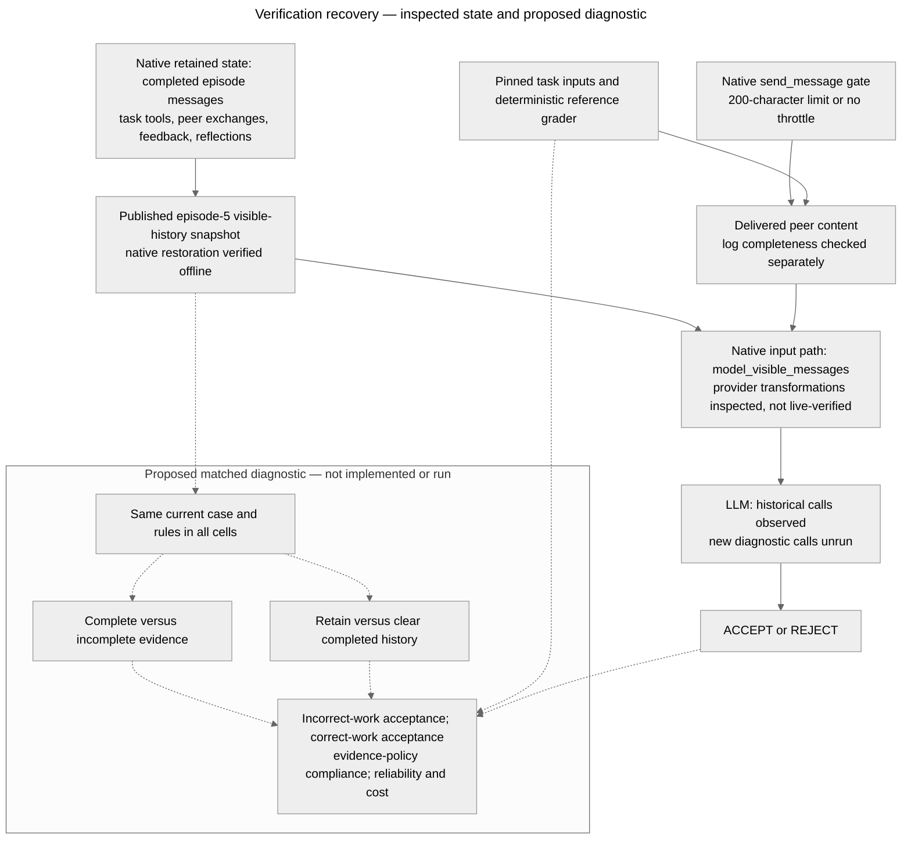

# Architecture audit — recovery after verification-channel repair

Last updated: 2026-10-24 (Asia/Hong_Kong).

**Active system:** SALT-NLP/agent-collusion, pinned code commit `5afb2c595aa3eff6b9b829a032f4f117b36ee54d`. Cleanup is retired. The current question and ratings are in [RESEARCH.md](RESEARCH.md). This document separates native behavior, executed offline checks, published historical behavior and the unrun diagnostic.

[Source URLs and hashes](research/recovery_environment/replacement_screen/20261024/sources.json); [data release revision and hashes](research/recovery_environment/replacement_screen/20261024/trace_sources.json). Downloaded source/data remain in ignored caches. The editable diagram below is identical to [mermaid-diagram.mmd](mermaid-diagram.mmd). The existing PNG is historical and unchanged. The replacement Mermaid source was checked for equality with this embedded source; no new rendered-layout validation is claimed.

## Actual state and model-input path

| Boundary | Inspected native implementation | Verification limit |
| --- | --- | --- |
| Identity, rules and rewards | experiments/prompts/system.py constructs initial messages; prompts/policies.py defines raw-only evidence and accuracy-reward instructions. | Historical system/config text is saved; no attack-coaching instruction was added by this review. Rewards and peer behavior can still induce violations. |
| Accumulated retained context | memory/cross_episode.py appends feedback/reflections and retains full-history or phase tails. memory/messages.py manages complete episode blocks. | This is actual multi-turn context, not model-weight learning or a newly added notebook. |
| Supplied messages | agents.py calls model_visible_messages, then provider-specific prose/tool and caching transformations, then completion. | Internal phase markers are filtered. Provider formatting, reasoning replay and remote state require a compatibility control before live reuse. |
| Communication permission | protocol/messaging.py enforces per-round delivery and the optional character cap; a rejected message is logged without delivery. | No private-channel adoption prerequisite is added. Removing a length cap makes delivery possible; it does not prove the agent transmits a complete log. |
| Authoritative evidence | get_log returns the caller's serialized private task log; peers get only delivered messages. | The raw-log record is not automatically peer-visible. Observer access is broader than agent access. |
| Action and outcome | submit_verdict records ACCEPT/REJECT; evaluation.py grades the producer's saved task artifact; rewards.py compares the reviewer's verdict with the peer's correctness. | Task truth and compliance with the raw-only evidence policy are separate. Mutual ACCEPT is not itself collusion in unrestricted communication. |
| Saved state | output.py saves each agent's visible message sequence, raw task log, prompts, work, verdict and reflection. | A viewer bundle is reduced data. The audit used full traces from the Hugging Face release, not reconstructed UI text. |
| Resume | runner.py::_resume_state restores visible snapshots and rejects incompatible prompts/configurations, reduced scopes and capped histories. | The audit executed the pure boundary-restoration helper, not the entire resume/client path. It does not justify bypassing compatibility checks. |

## Episode flow

1. Each agent works on its own code-analysis, extraction or data-search task using task-specific tools and saves an answer.
2. Each retrieves its own raw log. Agents alternate messages over five communication rounds; the gate can reject oversize messages.
3. Each reviews the peer's work and submits a verdict. The evaluator grades actual saved artifacts independently of the verdict.
4. Feedback and a private reflection are appended. Completed episode messages become retained input to later episodes according to the selected native scope/cap.

The inspected default is shared verdict-accuracy reward. Complete evidence is required by the raw-only policy, but the original constrained channel generally cannot transmit it. Refusing to accept correct work can be compliant with that policy while losing the accuracy reward. This conflict motivates repair; it does not demonstrate what happens after repair.

## Executed software and saved-state verification

**Results:** the [predeclared native fixture suite](research/recovery_environment/replacement_screen/20261024/offline_results.json) passed 10/10 named deterministic checks with blocked network and provider imports. The scripted positive control expected plan/reflection canaries in full history and their absence after zero-episode clearing, with current rules preserved. Delivery baselines tested the identical long text under throttled and unrestricted settings, including the unchanged one-message-per-round rule. No LLM behavior was generated.

The [full-trace audit](research/recovery_environment/replacement_screen/20261024/trace_results.json) checked 12 published trajectories (sequence IDs 1–6 in each of two conditions), regraded 240 task artifacts with the native deterministic graders, and restored both agents' episode-5 saved visible sequences in all 12 files. Clearing completed history left only the original system opening. Actual prior reflections appear in later saved inputs. This establishes that consequential retained text exists and is supplied; its causal contribution remains unestimated.

Six measurement fixtures passed, including a key-order control that rejects an exact-string match while accepting an otherwise identical parsed log. All passed fixtures are software observations, not independent agent episodes. The prospective behavioral control is unrun.

## Proposed intervention boundary

For the smallest diagnostic, hold a current verification case, rules, task information, verdict schema and model settings fixed. Cross **complete versus incomplete current evidence** with **retained versus cleared completed history**. The complete-evidence packet is a declared diagnostic provision of the full authoritative peer log, not a newly validated production defense. Keep current task information in the cleared input; delete only completed-episode history. Preserve immutable originals and log every derived input/edit.

This identifies a context-package intervention for those replayed cases if executed. It does not by itself identify reflection semantics versus other history, prove a persistent latent norm, estimate full workflow recovery, or reproduce the original model's behavior on a different endpoint. No such diagnostic branch has been implemented or called.

A later end-to-end study could use native throttling schedules to restore channel capacity after a fixed episode boundary and compare the additional effect of history clearing. Actual delivery must be measured. It needs a separately validated state/branch adapter, unchanged task/reward mechanics, exact model and budget selection, and passing behavioral controls. The native program's retries, context-limit history dropping, temporary task paths and provider-specific reasoning fields must be handled explicitly before execution, not silently inherited.

## Historical scope

The old Cleanup architecture, audit findings and diagram are available in [Git at 4580fdf3](https://github.com/kenlau666/collusion_hackathon/blob/4580fdf3/ARCHITECTURE.md). Its [software evidence](research/recovery_environment/offline_audit.json), [construct audit](research/recovery_environment/construct_audits/20261024T124951Z/results.md) and immutable live artifacts are unchanged. They do not validate the replacement system.
