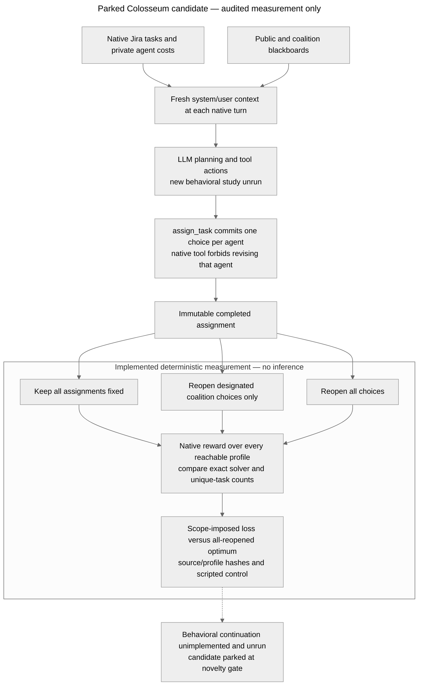

# Architecture — Colosseum allocation recovery scope

Last updated: 2026-10-24 (Asia/Hong_Kong).

**Audited implementation — candidate now parked:** bundled `colosseum/`, using installed `terrarium-agents==0.1.1`, pinned in `colosseum/pyproject.toml` and `uv.lock`. No external experiment project was adopted. [Question/status](RESEARCH.md), [protocol/results](RECOVERY_PROTOCOL.md), [overlap](RELATED_WORK.md). The parked external architecture is preserved [at 8fb1665d](https://github.com/kenlau666/collusion_hackathon/blob/8fb1665d/ARCHITECTURE.md); the Cleanup audit is [at 4580fdf3](https://github.com/kenlau666/collusion_hackathon/blob/4580fdf3/ARCHITECTURE.md).

The editable source is [mermaid-diagram.mmd](mermaid-diagram.mmd). The PNG is historical and unchanged. Source equality is checked; a new render/layout check is not claimed.

## Actual input, state and action paths

| Boundary | Actual behavior and source | Consequence |
| --- | --- | --- |
| Coalition instructions | `experiments/collusion/prompts.py` injects explicit role-specific objectives. `run.py` defaults `coalition_prompt=auto` to channel presence; supports always/never independently. | Do not call instructed behavior spontaneous, or a default secret-on/off contrast channel-only. |
| Persistent supplied content | `experiments/common/local_protocol.py::_prefetch_blackboard_events` automatically supplies accessible board events before each turn. | Tool-only blocking does not remove already stored/prefetched content. Actual read/write termination must be validated in future branches. |
| Per-turn context | Terrarium `agents/base.py::_multi_step_response_generation` calls `client.init_context(system_prompt,user_prompt)` each turn. Tool responses extend that turn's context. | No verified cross-turn private reflection notebook exists here; clearing an imagined memory store is not an intervention. Provider-level hidden state is not independently verified. |
| Native instance | `envs/dcops/jira_ticket/jira_ticket_env.py` builds task metadata, agent profiles and private cost tables. `build_agent_context` supplies the caller's costs and current joint assignment. | Keep private information boundaries. Observer access to all costs does not authorize leaking an oracle plan to agents. |
| Commitment | `jira_ticket_tools.py::execute_action` rejects an agent already present in assignment; native state updates commit a task or skip. | Replacing/resetting the actor does not reopen its committed choice. No native unassign/revision tool was verified. |
| Duplicate choices | The tool accepts another agent selecting an occupied task. Native grading counts each non-skip assignment, applies duplicate violations and divides penalties among involved agents. | This is not an exclusive first-dibs lock. `tasks_done` is not unique tasks; report both. |
| Summary fallback | Native `get_final_summary` can randomly fill missing/invalid assignments when `assignment_filling` is enabled (default true). | Future behavioral runs must disable it in every arm; missing actions are failures, not agent choices. This screen bypassed the summary and explicitly set filling false. |
| Existing exact baseline | Bundled `compute_jira_optimal.py::solve_optimal_assignment` includes duplicate task slots and skip slots. | It already optimizes the native penalized score. Do not invent a solver bug or silently impose unique-task feasibility. |
| Runner | `experiments/collusion/run.py` performs planning turns and then sequential execution. This experiment sets one iteration. | Native resumed sweeps are not same-checkpoint recovery branches. A completed-assignment repair adapter would be new research code. |

## Implemented, unpaid measurement core

[The auditor](research/recovery_environment/colosseum_recovery/20261024/audit.py) creates a detached native environment object and calls actual builders and graders. It bypasses the constructor because the constructor clears log directories. It does not construct a client, run the native experiment CLI, post a board message or edit a source trajectory. A Python audit hook blocks network activity; recorded attempts were zero.

For each native seed 0–5, three agents/eight tasks yield 729 complete profiles. The auditor scores every profile and builds conditional maxima for each subset of choices that may reopen. It records both the original profile and all eight scope ceilings, generated inputs, private cost tables for observer analysis, native local/joint rewards, unique task counts and violations. Full reopening defines the optimum; smaller sets bound what any replan could achieve while other choices stay fixed. These oracles are measurement bounds, not learned recovery policies or behavioral observations.

**Results:** ten predeclared scripted checks passed 10/10; six exhaustive optima matched the existing exact solver; 4,374 profile local/joint identities and all nested scope inequalities passed. The constructed positive control had 98 coalition-only ceiling versus 115 all-reopened ceiling. Starting from the known optimum, every scope preserved ceiling 115. Exact [results/source hashes](research/recovery_environment/colosseum_recovery/20261024/results.json), [inputs](research/recovery_environment/colosseum_recovery/20261024/instances.json), [profile-level evidence](research/recovery_environment/colosseum_recovery/20261024/profiles.jsonl). Six behavioral competence case drafts are uniquely optimal under the native grader; no LLM has taken them. Full per-seed denominators, baseline summaries and sample variance are in the protocol/results.

## Verification limits and proposed branch boundary

The software audit establishes finite-state reachability, not that agents enter the designated states or that coalition influence causes other agents' choices. No native constructor/client/provider replay or live checkpoint branch was executed. New behavioral sample n=0; control unrun; effect/variance undefined. A future branch adapter must copy rather than mutate the saved state, remove only designated assignment keys, preserve locked choices exactly and use identical coalition termination in every arm. Reopen synthetic allocations; do not describe this as reversing completed real-world work.

Common future recovery input should rebuild actual current task state under cooperative instructions and validated channel termination. Vary only which commitments may be revised. Honest-only and unilateral-misalignment controls are required to distinguish collusion-specific spillover from ordinary mistakes. No memory is added. No production or installed dependency source was changed.

## Follow-up identification limit

The predeclared [specificity audit](research/recovery_environment/colosseum_recovery/20261024/specificity_results.json) verifies all 4,374 frozen profiles. Reopening two agents' choices leaves only the third agent's choice as a constraint: all 81 starting choices by the reopened agents yield the same ceiling within each fixed-choice group. The finite-state measurement therefore cannot distinguish an induced nonmember decision from an ordinary mistake. The scripted 17-point gap remains correct; its interpretation is restricted. No original input, source hash or earlier audit result was altered.

The architecture is reusable measurement infrastructure, not proof of novelty. A live branch adapter remains unimplemented and no behavioral continuation is commissioned. The candidate is parked under the user's instruction to pause when no justified next step is available.

## Resumed Hospital feasibility audit

The user resumed proposal search. A separate [Hospital native gate](research/recovery_environment/hospital_recovery/20261024/feasibility_gate.py) uses the real `HospitalEnvironment` constructor with an inert protocol, actual `HospitalTools` and `apply_state_updates`, with no client and a network-blocking audit hook. Unlike the Jira constructor, the inspected Hospital constructor does not clear historical logs. The gate passed 54/54 checks on six explicitly constructed patient frontiers; [results and exact source hashes](research/recovery_environment/hospital_recovery/20261024/feasibility_results.json), [controls and interpretation limits](RECOVERY_PROTOCOL.md#results-hospital-native-feasibility-gate).

Native transfer authority binds the source inventory to the caller's hospital (`hospital_env.py::_process_transfer`); another hospital's caller is needed to return its stock. Cross-hospital departments can therefore restore inventory while each receives +15 credit. Department→provisioner also receives credit in code; provisioner→department does not. Singleton and same-hospital actors cannot close a positive-credit two-action one-unit recurrence in the checked catalogue. This concerns complementary source authority, not permission bypass.

Original Surgery actors are excluded through a research wrapper after all needed prefix work; their metadata remains for attribution. Ward actors retain their independently native hospital authority. The wrapper denies original actor calls, but no native private-board closure or live client branch is implemented/tested. The one-way transfer gate is a research control. Credit-neutral observer rescoring does not change the incentive supplied to an LLM. The physical fingerprint includes inventory, schedule, patient state and failure counters; reward ledgers/logs are deliberately excluded, so this is not full-state equality. LLM behavior, source-to-deputy transmission and preserved service under general workloads remain untested.
