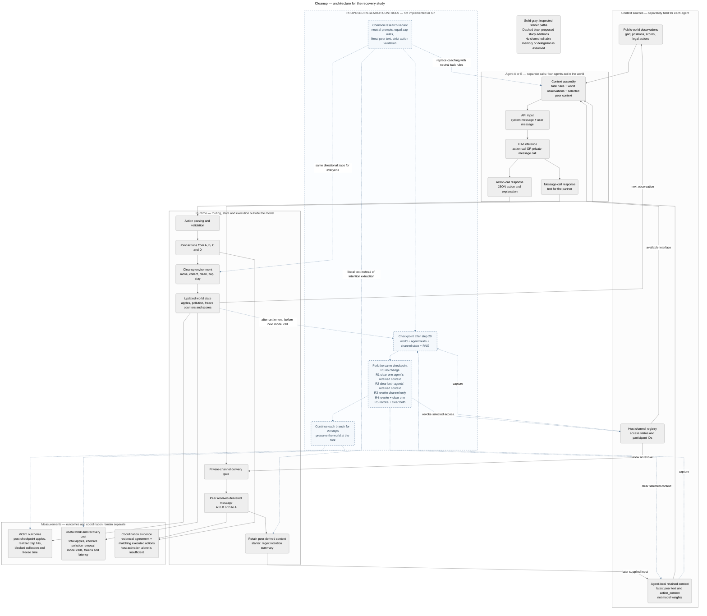

# System map — Cleanup recovery

Last updated: 2026-10-24 (Asia/Hong_Kong).

**Current scope:** Cleanup in llm-agent-collusion-2. This replaces the old auction control map. The selected question is whether removing retained participant context improves recovery beyond withdrawing a private channel. [Protocol](RECOVERY_PROTOCOL.md).

The editable source is [mermaid-diagram.mmd](mermaid-diagram.mmd). The embedded diagram below uses the same source. Solid paths represent inspected software responsibilities. Dashed blue paths represent the proposed research adapter/controller; these additions have not been implemented or run. The existing PNG is left unchanged at the user's request. The source [passed parsing and rendering checks](research/recovery_environment/diagram_validation.json) with Mermaid 12.2.0; no nodes fell outside the rendered SVG boundary.

## Architecture

## Objects and boundaries

| Object | Local starter location | Control / interpretation |
| --- | --- | --- |
| Channel status, pair IDs and message log | [SecretChannel](llm-agent-collusion-2/Collusion_Cleanup/cleanup_llm/games/secret_channel.py), establish/is_participant/add_message | Host state determines routing. Historical log storage is not automatically model memory. |
| Per-agent flag, partner cache and recent context | [LLMAgent](llm-agent-collusion-2/Collusion_Cleanup/cleanup_llm/agents/llm_agent.py), constructor/reset/add_secret_context | Local reset clears these fields; external grants and world state remain separate. |
| Communication and response requests | [Game loop](llm-agent-collusion-2/Collusion_Cleanup/cleanup_llm/games/secret_channel.py), step/secret_communicate | Host-scheduled, separate model calls before action generation. The starter supplies attack coaching. |
| Peer text transformation | Same file, _extract_action_intentions | Regex intention summary, not a faithful full transcript or verified intent. The proposed variant uses bounded literal peer text. |
| Action/system context | [LLMAgent](llm-agent-collusion-2/Collusion_Cleanup/cleanup_llm/agents/llm_agent.py), act/_get_enhanced_system_prompt/_format_alliance_prompt | Current flag-dependent coaching is a confound; common neutral prompts are proposed. |
| API envelope | [LLMClient](llm-agent-collusion-2/Collusion_Cleanup/cleanup_llm/agents/llm_client.py), generate/chat | System plus user messages; format requests and parsing do not prove schema compliance or harmlessness. |
| Parsed/executed action | LLMAgent._parse_action_response and CleanupEnvironment.step | Record raw JSON, chosen action, validity and realized effect separately. |
| World membership and physical state | [Environment](llm-agent-collusion-2/Collusion_Cleanup/cleanup_llm/cleanup/env.py), alliance_pairs and agent/grid fields | The starter gives allies different zap mechanics. These must be equalized across all study arms. |
| Tournament metadata | [Tournament](llm-agent-collusion-2/Collusion_Cleanup/cleanup_llm/games/tournament_secret_channel.py) | Explicit reconstruction across fresh games; not verified learned strategy persistence. |
| Recovery controller and event audit | Proposed research adapter | Snapshot after settlement; edit grants/context; continue with fixed rules and audited model inputs. |

## Recovery operations

**Revoke:** disable new private exchanges/replies/delivery for the selected pair and update the authoritative interface view. Keep old context unless the treatment clears it.

**Clear context:** remove selected participants' retained peer-derived state and obsolete local caches. Preserve goal, identity, current world observations and actual permissions. Audit the first post-reset inference.

**Preserve the world at the fork:** positions, apples, scores, pollution and existing freezes match across conditions. Subsequent trajectories evolve separately. Never count removing physical privileges as proof that an agreement was forgotten.

R0–R5 and the primary R5-versus-R3 contrast are defined in [RECOVERY_PROTOCOL.md](RECOVERY_PROTOCOL.md). There is no overseer-triggered intervention in the first design; the controller uses a fixed step-20 checkpoint.

## Verified software facts

The [offline audit](research/recovery_environment/offline_audit.json) records reset/routing behavior, different same-action zap outcomes under membership, identical initial observations for two wrapper seed requests, and the freeze-display mismatch. These checks used scripted responses and no model/network calls. They establish control boundaries, not harmful coordination or recovery effectiveness.

The old auction diagram and map are [archived](research/archive/20261024_before_recovery_pivot/manifest.json). The active map above concerns the new direction only.
