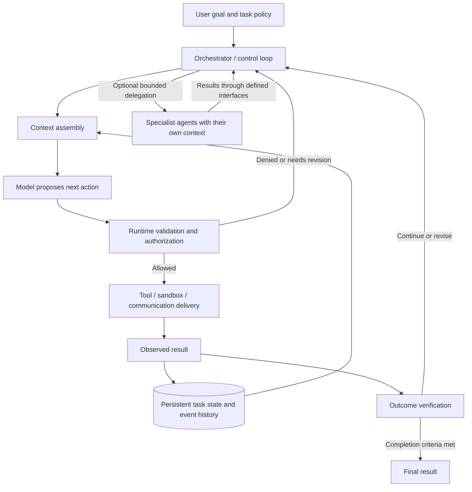

# Modern agent architecture — study notes

Last updated: 2026-10-24 (Asia/Hong_Kong)

## Scope and confidence

This is a preliminary study of publicly documented agent-system architectures, building on basic inference, context, tools, and agent loops. It concerns the software around a model, rather than the model's Transformer/MoE internals. It does not establish a universally best architecture or reveal private production implementations.

The sources mix engineering examples, framework documentation, and research evaluations. An implemented design is evidence that an approach is used; it does not establish that the approach is best or safe across settings. Our interpretations and research implications are identified separately. The communication-enforcement pilot is complete; the user has reopened question discovery with novelty as the priority.

## The organizing idea: model plus harness

A **harness** is the surrounding software that assembles inputs, runs the loop, executes tools, manages state, and applies controls. LangChain's March 2026 architecture article uses this framing and describes filesystem access, delegation, and middleware as harness components. This is a useful vocabulary, although teams draw the component boundaries differently. [Source: The Anatomy of an Agent Harness](https://www.langchain.com/blog/the-anatomy-of-an-agent-harness).

The diagram below is **our synthesis**, not a diagram of a particular vendor's implementation. These are logical responsibilities; they need not be separate services or separate models.



The important distinction is between **what the model proposes**, **what the runtime permits and executes**, and **what actually changes in the environment**. A proposal, permission decision, and successful outcome are different events.

## What each part does

| Part | Concrete responsibility | Main design question |
| --- | --- | --- |
| Model | Interpret observations and propose actions, plans, or answers. | What can this model handle reliably with the available context and compute? |
| Context assembly | Select instructions, task state, relevant history, retrieved information, and tool descriptions for the next inference. | What information should be visible now, and what is its source/trust level? |
| Orchestrator | Route work, schedule calls, handle stopping/retries, and optionally delegate. It may be ordinary code, model-driven, or a hybrid. | Which decisions are flexible, and which transitions must follow a fixed workflow? |
| Tools and execution environment | Read/write files, run code, browse, call services, or deliver messages. | What can this identity actually access or change? |
| Persistent state and memory | Retain plans, artifacts, checkpoints, and selected history beyond one inference. | What survives, who can read/write it, and how is it recovered? |
| Verification | Check outputs and environment outcomes against task-specific criteria. | Which checks are executable, and which remain fallible judgments? |
| Trace and operational controls | Record events, costs, errors, decisions, and limits. | Can we reconstruct why an action happened and bound a run? |

This decomposition is an analytical model, not a claim that every product implements every responsibility well.

## Five consequential design directions

### 1. Separate persistent state from the model's working context

The complete task history can live outside the context window. The runtime selects a working view for each inference; summaries, retrieval, and files help manage that view. External memory does not automatically update model weights or make its contents true. Anthropic discusses compaction, notes, and focused subagent contexts as different strategies with different tradeoffs. [Source: Effective context engineering for AI agents, September 2025](https://www.anthropic.com/research/effective-context-engineering-for-ai-agents).

In technical terms, let `S_t` be the stored task state and `C_t = select(S_t, task, policy)` be the context shown to the model. Changing the context-selection function changes behavior without changing the model. For our research, it also changes which information agents can share or recover. That is a hypothesis-generating observation, not evidence of a covert channel.

### 2. Decouple the loop, event history, and execution environment

Anthropic's April 2026 Managed Agents write-up separates the harness, an append-only session log, and sandboxes/tools. The harness can recover using stored events, and a failed execution environment can be replaced independently. Its session history remains recoverable even when the current model context is compacted. [Source: Scaling Managed Agents](https://www.anthropic.com/research/managed-agents).

Related framework support includes LangGraph checkpointers for thread state and stores for cross-thread information. Persistence supports continuation and recovery; the particular storage implementation determines durability. [Source: LangGraph persistence documentation](https://docs.langchain.com/oss/python/langgraph/persistence).

**Engineering implication:** recovery must account for external side effects. Resuming a session should not accidentally repeat an already committed action. A saved conversation alone does not establish that an external operation is safe to replay.

### 3. Use delegation selectively, with explicit ownership

OpenAI documents two different coordination patterns: a manager can call specialists as tools and retain responsibility, or a handoff can transfer control to another agent. These imply different routing and review boundaries. Separate agent roles do not require separately trained model weights. [Source: OpenAI orchestration and handoffs](https://developers.openai.com/api/docs/guides/agents/orchestration).

Google's January 2026 study evaluated 180 configurations across four benchmarks, including single-agent, independent, centralized, decentralized, and hybrid designs. It reports gains on parallelizable work and losses on sequential planning tasks. Those results are task- and experiment-dependent, rather than a rule that one topology always wins. [Source: Towards a science of scaling agent systems](https://research.google/blog/towards-a-science-of-scaling-agent-systems-when-and-why-agent-systems-work/).

| Structure | Control and information flow | Question to ask |
| --- | --- | --- |
| Single agent | One loop uses tools and maintains task context. | Is the task already manageable without coordination overhead? |
| Manager with specialists | Bounded tasks go out; results return to a manager. | What does the manager see and verify? |
| Handoffs | Responsibility moves between agents. | Which policy and history follow the transfer? |
| Peer network | Agents communicate directly along permitted edges. | Which interactions are necessary, and which can be observed or constrained? |
| Hybrid | A manager and some peer communication coexist. | Do the extra paths create benefits that justify their complexity? |

The questions in the table are our design analysis. A supervisor role or separate context is not by itself a security boundary; permissions and shared resources must be inspected.

### 4. Check actual outcomes and adapt the harness to the model

Anthropic's March 2026 application-building experiment used planner, generator, and evaluator agents. The evaluator exercised the running application. The authors also describe simplifying scaffolding as models improved, and acknowledge evaluator errors and costs. This is an engineering case study, not proof that every agent needs three roles. [Source: Harness design for long-running application development](https://www.anthropic.com/research/harness-design-long-running-apps).

**Our interpretation:** architecture is a hypothesis about what the current model needs help with. Test whether each additional component contributes enough benefit to justify its cost. A claimed success in the conversation should be checked against the environment, using executable tests where suitable; an LLM evaluator remains a fallible measurement instrument.

### 5. Place enforcement at the operation it governs

OpenAI distinguishes input, output, and tool guardrails. Its documentation warns that agent-level checks do not automatically cover every nested tool operation, and recommends placing validation near the tool that creates the side effect. [Source: OpenAI guardrails and human review](https://developers.openai.com/api/docs/guides/agents/guardrails-approvals).

For our purposes, distinguish three layers:

- **Prompt policy:** tells the model what behavior is desired.
- **Decision/check:** determines whether a proposed operation meets a condition; this could be deterministic code, a learned monitor, or both.
- **Enforcement:** prevents, transforms, or pauses the operation before it takes effect.

A deterministic length check can establish a message-length property on a controlled delivery path. A learned monitor's semantic judgment remains fallible even when code reliably enforces its decision. Post-action detection can inform the next step, but cannot retroactively prevent an earlier side effect. These are our architectural deductions, not empirical findings about collusion.

## Where frameworks, protocols, and skills fit

An agent framework supplies reusable building blocks; it does not determine a uniquely best design. A workflow graph specifies transitions and state. A skill supplies task-specific instructions or resources. These operate at different levels and can be combined in one harness.

MCP supplies a client/server protocol for exchanging context and exposing capabilities. Its specification explicitly leaves model use and context management to the host application. The protocol does not, by itself, choose an agent topology or establish a collusion-prevention policy. [Source: MCP architecture overview, documentation version 2026-07-28](https://modelcontextprotocol.io/docs/2026-07-28/learn/architecture).

## Connection to the diagnostic question

See [SYSTEM_MAP.md](SYSTEM_MAP.md) for the consolidated component map, exact control locations, JSON boundaries, and prompt order. It connects this architectural overview to the next [causal influence study](CAUSAL_INFLUENCE.md).

A focused follow-up, [How one agent's output becomes another agent's context](AGENT_CONTEXT_FLOW.md), traces these paths through the actual auction code and includes an offline scripted verification. Consult it for field routing, delivery timing, and the precise recipient input.

Our first proposed experiment changes a specific harness operation:

```text
seller model generates a message
    -> delivery policy is applied, if enabled
    -> exact delivered message is recorded
    -> peers receive that version in their next context
```

However, peers may also observe market actions or read shared artifacts. **Our inference:** the architectural scope of a communication rule includes every path by which one agent can influence another's future observations. A chat-length experiment still has value, provided we explicitly limit its claim to that path and examine remaining observations.

Before implementation, map agent identities, visible state, message routes, shared storage, tool permissions, and enforcement points. This provides a concrete way to check whether our treatment changes what we think it changes. Details of the proposed comparison remain in [DIAGNOSTIC_QUESTION.md](DIAGNOSTIC_QUESTION.md).

## A useful order for studying this

1. Trace a single loop: state → selected context → model proposal → runtime decision → execution → observation.
2. Add persistent state, then inspect what compaction retains and how lost detail can be recovered.
3. Compare a manager/specialist call with a handoff; identify who owns the next decision and which context is transferred.
4. Trace a communication restriction across all relevant delivery and observation paths.
5. Evaluate a proposed architectural change with task success, safety outcomes, latency/cost, and suitable controls.

An additional research direction is automated architecture design: Google's MASS work jointly considers prompts and interaction topologies. Its publication page describes a pruned search process and emphasizes the importance of prompts and simpler design spaces. A close methods review is still needed before applying or generalizing its findings. [Source: Multi-Agent Design: Optimizing Agents with Better Prompts and Topologies, ICLR 2026](https://research.google/pubs/multi-agent-design-optimizing-agents-with-better-prompts-and-topologies/).

## Open questions and evidence limits

### Scope of our completed auction pilot

The user raised the limited action space as a concern for architectural relevance. The [saved context/memory review](CONTEXT_MEMORY_REVIEW.md) separates the narrow connection from broader claims: the auction implements context assembly, state restoration, broadcast routing and delivery enforcement, but exposes only orders, messages and private-state updates to agents. It provides no agent-accessible tools, delegation, handoffs or shared editable artifacts. B/C changes delivery enforcement within this fixed architecture; it does not compare architectures or memory policies.

The live-artifact audit verifies actual state persistence and documents unverified narratives and pre-settlement notes in later context. That makes context/state a concrete component to study, without establishing a causal failure or choosing a new design. The narrow action space aids measurement; adding tools/actions would need a specific research justification. No architecture redesign or replacement task is selected.

The subsequent [component recommendation](CONTEXT_MEMORY_REVIEW.md#follow-up-component-recommendation) prioritizes private strategy-state restoration, pending user selection. A focused original-source check finds substantial existing work on collusion history ablations and memory/interpretation quality. Thus the recommendation concerns a narrow claim-specific causal question, not novelty of memory control or a commitment to a defense. Sources, exact versions, the research skill and a falsifier are recorded there.

The later [methods-level prior-work assessment](MEMORY_PRIOR_WORK.md) further weakens the novelty case: localized memory interventions and replay attribution already exist. Editing the scratchpad in a captured input can measure a text contribution but does not alone compare memory architectures or establish the formation path of that text. The [test draft](MEMORY_TEST_PROTOCOL_DRAFT.md) is limited to a diagnostic case study; no architecture intervention or defense is implemented/evaluated by preparing its inputs.

- Which components help our chosen model and task, and which only add overhead?
- How much useful context is lost or distorted during summarization and handoffs?
- Do communication controls cover shared artifacts, tool results, and public actions, or only a named chat API?
- Can we distinguish errors caused by the model, context selection, routing, enforcement, and verification?
- Which findings generalize beyond the models, tasks, and budgets tested?

The public-architecture overview itself implements no new architecture. The later auction pilot implements a specific delivery control and evaluates it within one fixed harness; it does not evaluate competing architectures. Vendor examples are not independent replications. These notes are a starting map of public designs, not an exhaustive frontier survey or a confirmed research gap.

## Method and skill

### Later research implication: recovery scope

The [novelty direction assessment](NOVEL_RESEARCH_DIRECTIONS.md) distinguishes documented recovery designs from a new hypothesis. [SafeFlow v3, §3.2 and Appendix C.2](https://arxiv.org/abs/2506.07564v3) already describes dependency-based rollback; [FLP v3](https://arxiv.org/abs/2605.01758v3) already studies targeted purification; [MESA v1](https://arxiv.org/abs/2606.30602v1) prioritizes communication edges. These are existing approaches, not our inventions.

Our candidate question concerns whether a retained live coalition can restore an unsafe agreement after a precisely specified cleanup, beyond fresh formation under unchanged incentives. Private state, peer exposure, shared artifacts and retained authority would be separate intervention surfaces. The current auction implements only a subset. No recurrence mechanism, new recovery algorithm, or safety guarantee has been established. The user has not selected a replacement task; the earlier local memory recommendation is parked. The detailed assessment records the research skill, source versions, competing explanations and next novelty checks.

The user subsequently proposed `llm-agent-collusion-2` as a recovery setting. The [offline assessment](RECOVERY_ENVIRONMENT_ASSESSMENT.md) locates separate local flags/context, channel state, world privileges and tournament reconstruction. These make control coverage concrete, but Cleanup also supplies alliance coaching and enhanced zap mechanics; Liar's Bar's secret-series memory is not verified. This is a candidate game harness, not an implemented general tool/delegation architecture or proof of a new recovery mechanism.

Consulted original vendor/framework documentation and research publication pages on 2026-10-24. OpenAI-specific guidance used the [OpenAI Docs skill](/Users/kenlau/.codex/skills/.system/openai-docs/SKILL.md). Research implications and the reference diagram are our synthesis. Recheck changing documentation before implementation and pin the implementation versions used in any experiments.
