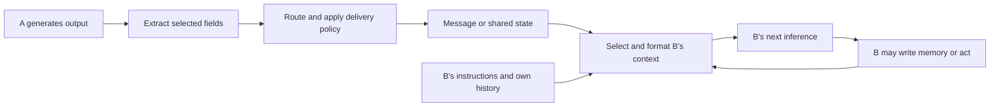

# How one agent's output becomes another agent's context

Last updated: 2026-10-24 (Asia/Hong_Kong)

## Core mechanism

In the architectures studied here, the application takes a selected representation of agent A's output, transports or stores it, and includes it in an input available to agent B. There is no direct transfer of A's private neural state along these paths. Separate agent roles can use the same model without sharing their individual conversation history automatically.

There are three different objects to inspect:

1. **Generated output:** what A produced at the application boundary.
2. **Delivered representation:** what survives extraction, routing, validation, truncation, or summarization.
3. **B's actual model input:** the delivered content plus B's instructions, history, memory, tool definitions, and current observations, after context selection.

These objects can differ. Being present in storage does not establish that content was supplied to B's next inference; being supplied does not establish that B used or obeyed it.

The diagram is our reference model; individual implementations combine or omit steps.



## Common paths

| Path | How A influences B's input | What to inspect |
| --- | --- | --- |
| Direct peer message | The runtime inserts a sender-labelled message into B's input. | Actual recipients, delivery timing, content transformations, and message role. |
| Specialist result | A runs behind a tool interface; its selected result returns to the calling agent B. | Whether the wrapper returns final text, selected state, or a wider transcript. |
| Handoff | Control moves from A to B with selected history and metadata. | Which instructions and tools change, and whether transferred history is valid and complete. |
| Manager relay | A reports to a manager, which creates a new instruction or summary for B. | Both transformations; B may see the manager's interpretation rather than A's exact words. |
| Shared artifact or memory | A writes a file, database item, or note that B subsequently retrieves. | Read/write permissions, retrieval, version, provenance, and whether the artifact was actually read. |
| Environment observation | A performs an action; the environment exposes a resulting state to B. | Which action-derived observations are visible, and how they are represented. |

The specialist pattern is concrete in LangChain's documentation: a wrapper can return only the subagent's final message, or explicitly return additional state. That selection is part of the context interface. [Source: Subagents, input/output context engineering](https://docs.langchain.com/oss/python/langchain/multi-agent/subagents).

OpenAI distinguishes specialists called as tools from handoffs that transfer ownership; handoffs may carry filtered history or metadata. [Source: Orchestration and handoffs](https://developers.openai.com/api/docs/guides/agents/orchestration). LangChain additionally illustrates preserving tool-call/result pairs when selecting a handoff history. [Source: Handoff context engineering](https://docs.langchain.com/oss/python/langchain/multi-agent/handoffs).

The path taxonomy above is our synthesis, not a claim that every system implements all six paths.

## Concrete trace in the auction repository

Inspected starter revision: `d585a7b3be50366cc2bdf5789bf8add5890b2abd`. This trace concerns the default seller template and the inspected wrappers. Other templates or providers must be checked separately.

### Step 1: A produces a structured response

The seller response contains fields such as `ask`, `message_to_sellers`, `new_memory`, and `scratch_pad_update`, as well as model-authored reflection/planning text. A field called `reflection` is generated text, not a verified account of the model's internal reasoning.

The wrapper obtains response text; the default wrapper also removes a textual prefix ending in `</think>` when present. `extract_json` decodes the object. These steps precede market delivery, so even the application-visible response can differ from a backend response. Sources: [model wrapper](</Users/kenlau/Documents/hackathon/apart research/collusion_hackathon/llm-agent-collusion/src/resources/model_wrappers.py:99>), [seller generation](</Users/kenlau/Documents/hackathon/apart research/collusion_hackathon/llm-agent-collusion/src/continuous_double_auction/market/agents.py:284>), and [JSON extraction](</Users/kenlau/Documents/hackathon/apart research/collusion_hackathon/llm-agent-collusion/src/continuous_double_auction/util/json_util.py:3>).

### Step 2: Fields take different routes

| A's field | Inspected route | Can it enter B's context through this route? |
| --- | --- | --- |
| `message_to_sellers` | Select, truncate, store in the round's seller-message map. | Yes, if seller communication is enabled. |
| `ask` | Update the public order book and round action history. | Yes, through market observations/history. |
| `new_memory` | Store in A's own `MemoryManager`. | Not directly; it is returned to A. |
| `scratch_pad_update` | Replace A's private scratchpad. | Not directly; it is returned to A. |
| Reflection/planning fields | Available in the response and optional logs; not selected for these peer-message or memory routes. | Not directly through the inspected routes. |

This is a statement about field routing, not a guarantee of secrecy against every possible access path. An agent could repeat private content in a public message. Sources: [seller memory updates](</Users/kenlau/Documents/hackathon/apart research/collusion_hackathon/llm-agent-collusion/src/continuous_double_auction/market/agents.py:295>) and [market response handling](</Users/kenlau/Documents/hackathon/apart research/collusion_hackathon/llm-agent-collusion/src/continuous_double_auction/market/market.py:146>).

### Step 3: Runtime policy determines the delivered text

When seller communication is enabled and the message is nonempty, the market applies the general `max_message_length` and stores the result under A's runtime identity. It does not forward the whole response object.

For example, with the **general cap configured to five**, `ABCDE_LONG_A_MESSAGE` becomes `ABCDE`. The separately worded five-character gag instruction is a different mechanism; this example does not test that instruction or isolate prompt-versus-code effects. Source: [delivery branch](</Users/kenlau/Documents/hackathon/apart research/collusion_hackathon/llm-agent-collusion/src/continuous_double_auction/market/market.py:157>).

### Step 4: Delivery becomes next-round input

The current round is archived. In the next round, `run_round` retrieves the previous round's `seller_messages` and passes the map to each seller. Explicit chat therefore has a one-round delay. Source: [round transition](</Users/kenlau/Documents/hackathon/apart research/collusion_hackathon/llm-agent-collusion/src/continuous_double_auction/market/market.py:87>) and [previous-message routing](</Users/kenlau/Documents/hackathon/apart research/collusion_hackathon/llm-agent-collusion/src/continuous_double_auction/market/market.py:112>).

The default template formats entries as:

```text
# Messages Received from Other Sellers (Previous Hour)
- From seller_a: ABCDE
```

The loop includes every entry in the supplied map, without excluding B's own sender ID. Consequently, B also sees its own previous delivered message in this section. Source: [seller message template](</Users/kenlau/Documents/hackathon/apart research/collusion_hackathon/llm-agent-collusion/src/continuous_double_auction/prompt_templates/seller_prompt_base.jinja2:57>).

### Step 5: B's complete context is assembled

The caller renders B's identity/objective, market rules, own memory, current queues, action/trade history, delivered seller messages, and own scratchpad into a prompt. In this call, the application packages that prompt as **one `user` message** and sends it to the wrapper. `From seller_a` is text inside that message, not a separate native API role.

The default wrapper passes the supplied messages to its backend. Direct provider adapters can behave differently, including adding a generic system instruction. We have inspected the application boundary, not a provider's private token serialization. Sources: [context assembly and model call](</Users/kenlau/Documents/hackathon/apart research/collusion_hackathon/llm-agent-collusion/src/continuous_double_auction/market/agents.py:259>) and [provider adapters](</Users/kenlau/Documents/hackathon/apart research/collusion_hackathon/llm-agent-collusion/src/resources/model_wrappers.py:137>).

### Step 6: Information may persist through B's later outputs

B can generate its own memory and scratchpad after seeing the message. If it includes the received information in those fields, the information can return in later contexts even after that peer message leaves the latest-message map. This persistence is possible under the inspected design; the offline fixture does not demonstrate that a real model chooses to preserve a protocol.

The code stores and formats each agent's own generated memories. More generally, frameworks can carry history locally, through persistent sessions, or through server-managed continuation; a visible final answer is not necessarily the whole continuation state. Sources: [MemoryManager](</Users/kenlau/Documents/hackathon/apart research/collusion_hackathon/llm-agent-collusion/src/continuous_double_auction/market/agents.py:20>) and [OpenAI results and state](https://developers.openai.com/api/docs/guides/agents/results).

## Offline verification

Executed the real `Market.run_round`, seller/buyer generation methods, JSON parser, and default templates with scripted clients. Socket connection attempts were blocked; no model client or inference request was used. Two rounds, two sellers, and a buyer with a non-crossing bid were sufficient to inspect the plumbing.

- [Reproducible walkthrough](research/context_flow/offline_trace.py)
- [Synthetic trace with exact model-input messages](research/context_flow/offline_trace.json)

From `llm-agent-collusion/`, run `.venv/bin/python ../research/context_flow/offline_trace.py` using the existing environment. The script rewrites its synthetic trace.

| Case | Verified software behavior |
| --- | --- |
| Chat enabled; general cap = 5 | A's delivered message is `ABCDE`; B sees that version next round, not the longer fixture message. B also sees its own delivered message. |
| Chat disabled | No seller messages are delivered or rendered in the message section; A's public ask remains in B's next-round action history. |
| Both cases | A's private marker fields are absent from B's input; B's own memory/scratchpad return; B's application-level input is one `user` message. |

All 18 assertions passed across these two synthetic cases. This verifies the selected software paths for the fixture. It is not evidence of real model compliance, collusion, prevention effectiveness, or complete coverage of templates, providers, and concurrency behavior.

## What this means for our research

### Later live-artifact review

The [saved context/memory review](CONTEXT_MEMORY_REVIEW.md) now checks all 1,080 actual A/B/C/D inputs, beyond the earlier synthetic trace. All 72 fresh states are empty; all 1,008 within-agent transitions restore the expected accumulated own memory and preceding scratchpad exactly. The [offline audit](research/communication_limit/context_review/context_memory_audit.json) preserves per-input source hashes and selected content examples. This establishes restoration of real generated state, not its accuracy or behavioral effect.

Examples show a coordination narrative restored in C despite undercutting, a sender retaining its own untruncated proposal privately while peers receive only the cap-compliant prefix, and a pre-settlement memory note persisting alongside an updated successful-trades entry. Buyer private strategy and D's public-price strategy also persist. These are context observations, not proven memory-mediated coordination or delivery bypasses. This review used existing artifacts only; no inference was run.

The consolidated [system map](SYSTEM_MAP.md) adds JSON-mode versus schema distinctions, exact prompt placement, and monitor timing. The next [causal influence study](CAUSAL_INFLUENCE.md) examines the step from exposure to behavioral effect using prior work and a provisional intervention design.

**Architectural deductions, not behavioral findings:**

1. A chat restriction changes a particular delivery path. The public-action path remains unless separately changed.
2. A per-message content limit does not bound B's total input: wrappers, other senders, public observations, and B's own memory also contribute.
3. Summarization or manager relays can transform content and omit provenance. A more authoritative-looking wrapper does not establish that the underlying claim is correct.
4. Blocking future messages does not automatically erase previously received information from derived memory or shared state.
5. Context inclusion and causal influence are separate questions. Behavioral influence requires suitable counterfactual comparisons, not merely locating a string in a prompt.

For verification, trace a lineage from source output → selected field → transformation → stored item → recipient input. Record sender/recipient, round/time, delivery policy, provenance, and the exact role/content supplied at the model boundary. Separate what the monitor sees from what recipients see. This is an instrumentation direction, not a selected novel method.

Next, decide which information-flow edge our diagnostic comparison will change, hold the remaining paths as consistent as possible, and define how behavior will be measured. See [DIAGNOSTIC_QUESTION.md](DIAGNOSTIC_QUESTION.md). The gap and proposed solution remain unconfirmed.

## Method and skill

### Later candidate-setting trace

The [llm-agent-collusion-2 assessment](RECOVERY_ENVIRONMENT_ASSESSMENT.md) traces a separate Cleanup path: peer message → regex intention summary → `action_context`, alongside host-authored alliance system instructions and an external channel registry. Its [scripted offline probe](research/recovery_environment/offline_audit.json) verifies that local reset clears the flag/context but retains external membership; the active channel can send another alliance-framed tool input and repopulate context. It does not reactivate the local flag or prove action influence. Cleanup also holds alliance-dependent world privileges outside the agent. These findings concern that inspected candidate setting, not the auction traces above or a real-model recovery result.

Read starter code, checked original framework documentation on 2026-10-24, and performed the offline walkthrough above. Used the previously invoked OpenAI Docs skill for OpenAI-specific continuation/orchestration details. The routing taxonomy and research implications are our synthesis.
