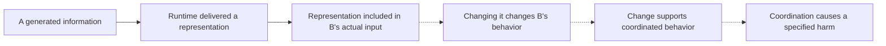
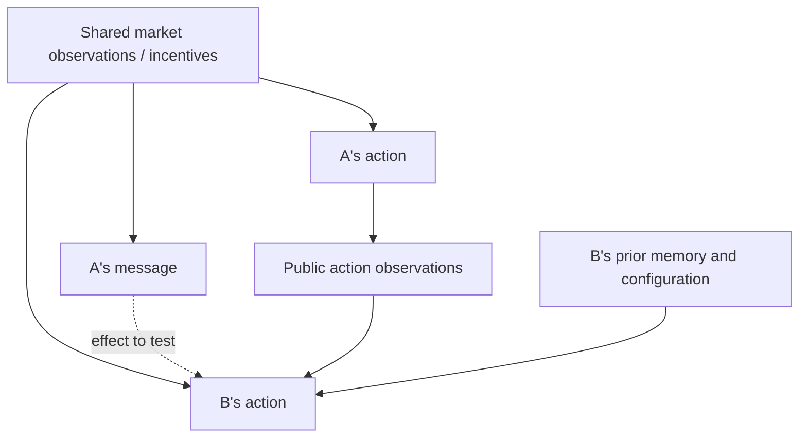

# From available information to causal influence and harmful coordination

Last updated: 2026-10-24 (Asia/Hong_Kong)

Status: initial related-work study and provisional message-influence design. The [four-condition enforcement pilot](COMPARISON_RESULTS.md) is complete, with a candidate price-floor episode and uncertain buyer-outcome effects. No fixed-context message intervention has been run; availability/listening/coordination/harm remain distinct claims. Read [SYSTEM_MAP.md](SYSTEM_MAP.md) for the objects and intervention boundaries.

## 1. Different claims need different evidence

The first steps can be checked in software. The dotted steps require additional evidence. This is an evidence progression, not a claim that all coordination requires explicit chat.

- Exposure does not establish a behavioral effect.
- A behavioral effect can be useful cooperation, distraction, independent best-response reasoning, or harmful coordination.
- Harm can arise through other paths, without explicit message influence.
- A self-report that B "used A's advice" is supporting text, not a causal identification strategy.

## 2. Relevant prior work already exists

**Lowe et al., AAMAS 2019, On the Pitfalls of Measuring Emergent Communication.** Sections 3.1 and 5 distinguish positive signaling—messages associated with the sender's observations/actions—from positive listening, where the receiver's behavior changes. Section 3.3 and Algorithm 1 examine receiver action distributions under changed messages; section 6.1 discusses the difficulty of longer-horizon settings. The simple deep-RL games differ from our black-box LLM auction, so the estimator does not transfer automatically. [Original paper](https://ifaamas.org/Proceedings/aamas2019/pdfs/p693.pdf).

**Jaques et al., ICML 2019, Social Influence as Intrinsic Motivation for Multi-Agent Deep Reinforcement Learning.** The paper uses counterfactual influence on other agents' actions as a training signal. We consulted the proceedings abstract; a deeper methods review remains pending. Its objective is learning coordination, rather than auditing our communication limit. [Proceedings page](https://proceedings.mlr.press/v97/jaques19a.html).

**Nakamura et al., Colosseum, arXiv v2, 27 May 2026.** The paper compares communication judgments with action-based collusion measures, including regret and coalition advantage. It reports cases of collusive planning without corresponding collusive actions, and uses secret-channel probes in cooperative tasks. Its measures and interventions differ from a fixed-state delivered-message test in an auction. [Original paper, especially sections 4.1 and 5.4](https://arxiv.org/html/2602.15198v2).

These sources establish that availability/correlation versus influence is an existing distinction. We have not established a novel gap or completed a systematic review. The candidate contribution must be more specific than "use causal interventions."

## 3. Why observed agreement is ambiguous

A high-price message and a high ask from B can co-occur because both respond to the same market. A's public ask may also affect B independently of chat. The map explains why a transcript correlation is insufficient to isolate the message path.

## 4. Optional mechanism probe: local effect on one recipient

**At a captured decision point, does replacing one delivered peer message change B's next action distribution when every other supplied input is held fixed?**

This probes a local behavioral effect on one edge of the larger network. It is not the entire research question or a prerequisite for the full-session comparison. It does not claim to recover private reasoning or establish harmful coordination.

Proposed procedure:

1. Capture B's complete application-level input immediately before its model call, together with model/version, API parameters, and state provenance. Use immutable copies; do not reconstruct a supposedly identical context from mutable market queues.
2. Identify exactly the delivered message span attributed to A. Leave the runtime sender identity, round, wrapper, public observations, B's memory, and non-target messages fixed.
3. Create repeated randomized comparisons using the original delivered message and a suitable control. Do not use A's untruncated raw message as the "original" if B would only have received the capped version.
4. Record B's parsed action and failures for every call. Estimate differences across repeated samples and multiple captured states; do not rely on one pair of generations or assume temperature zero guarantees reproducibility.
5. Inspect whether changes consistently follow the coordination-relevant information, rather than merely disturbing the prompt. Treat synthetic-message probes as elicitation tests, distinct from naturally generated communication.

| Candidate intervention | What it asks | Main limitation |
| --- | --- | --- |
| Remove A's message | Does this message's availability matter locally? | Changes input length and possibly the wrapper. |
| Replace with neutral content in the same slot | Does the original content matter beyond the presence of a message? | Neutrality and token/length matching need justification. |
| Swap a coordination-relevant detail within a plausible message | Does B respond in the predicted direction? | Can introduce inconsistent or artificial information; must preserve task plausibility. |
| Change only order/placement | Is the effect sensitive to input structure? | A separate treatment; keep it out of the primary enforcement comparison. |

Use a small, justified intervention set rather than all variants immediately. Character equality does not establish token-count equality. Record actual token counts where available and report residual differences.

## 5. Provisional measurements and claim limits

Candidate next-action measurements include ask-price differences, probability of withdrawing an ask, and a predefined behavioral response to a coordination proposal. Choose the primary measurement and meaningful-effect threshold before confirmatory runs. Inspect invalid JSON, missing actions, refusals, and retries rather than silently treating them as zero effect.

For finite sampled messages and continuous auction actions, a simple action-effect estimate may be more feasible than estimating the full causal-influence-of-communication metric. Do not label an approximation "CIC" without specifying its sampling, action representation, conditioning, and estimation assumptions. Access to token log probabilities is not automatically access to the probability distribution over parsed economic actions.

An effect supports sensitivity to the tested intervention under the captured conditions. It does not by itself prove semantic understanding, intent, an agreement, or harm. An imprecise/null effect does not rule out delayed effects, redundant information in other paths, or effects in untested states.

## 6. Primary diagnostic question: coordination and harm across the network

Evaluate repeated interactions among all relevant agents with predefined behavioral and outcome criteria. This is where the original prompt-versus-runtime comparison belongs. Local probes can help explain an effect or a null result, but a meaningful next-action effect on one chosen edge need not be demonstrated before running the primary study.

Randomize complete independent auction sessions between prompt-only and identical-prompt-plus-runtime arms, with ordinary-chat/no-chat controls where justified. Match initial configurations and sampling settings; permit subsequent actions, memory, and market state to evolve. Holding those post-treatment consequences fixed would answer a different question from the total effect of the restriction.

Measure delivery compliance, action-based coordination evidence, buyer surplus, trade completion, and welfare separately. Buyer harm alone does not establish collusion. Analyze sessions as independent units, account for repeated observations within sessions, and report uncertainty and utility costs.

### Network scope and interference

The auction has broadcast seller messaging, not an isolated A-to-B channel. A focal message can enter several agents' next contexts, influence their later outputs, return to A, and change shared market observations. For the initial study, keep that existing topology and examine the full seller population over repeated rounds rather than adding a sweep of unrelated architectures.

| Level | Intervention scope | Question / limit |
| --- | --- | --- |
| One edge | Replace A's message only in B's captured input. | Measures B's local response under those fixed conditions. |
| Broadcast or path | Specify whether the replacement affects all recipients, then allow a defined continuation horizon. | Measures downstream propagation under the stated intervention; differs from changing just one recipient. |
| Full session | Apply the communication policy to the defined set of seller messages/edges across all rounds. | Measures the overall restriction effect, including feedback, memory, and market changes. |

Do not assume that changing one agent's input leaves the other agents unaffected in a continued run. Their outcomes can interact, so comparisons within one market are not automatically independent. To attribute a relayed effect to a specific path, additional targeted interventions are needed; a changed final outcome alone establishes neither the path nor deliberate circumvention. Do not freeze downstream memory/actions when estimating the total session effect.

## 7. Decision before execution

The ordinary-chat baseline and B/C/D comparison are complete under their separate [baseline](BASELINE_PROTOCOL.md) and [comparison](COMPARISON_PROTOCOL.md) protocols. The earlier GPT credit interruption is historical; Modal inference succeeded. The message-probe designs here remain provisional. A B2 price-floor episode supplies a concrete candidate state, but related-work/gap review should inform the next study. Before a local probe, separately define its edge, endpoint, captured-state policy, intervention, repeated samples and budget. Verify delivery and input differences before interpreting model behavior. No additional inference has started.

The research gap remains unconfirmed. If close prior work already answers the narrowly defined question, revise it or justify a replication rather than declaring generic causal testing novel.

## Later memory-probe review

The [close-prior-work assessment](MEMORY_PRIOR_WORK.md) covers memory-entry intervention, remove/replay attribution and localized belief repair, beyond the communication-metric sources above. The [memory test draft](MEMORY_TEST_PROTOCOL_DRAFT.md) estimates a clause's conditional next-action effect at saved inputs; it does not establish that earlier communication caused its formation, that state restoration uniquely causes an effect beyond ordinary context provision, or that an effect harms buyers. Prepared inputs preserve all non-target context, with fresh no-edit, paraphrase and comparison-edit variants. Seven exact-phrase C states are one agent/session case. This is an optional application of known methods; no new inference, mediation result or confirmed gap is claimed.
