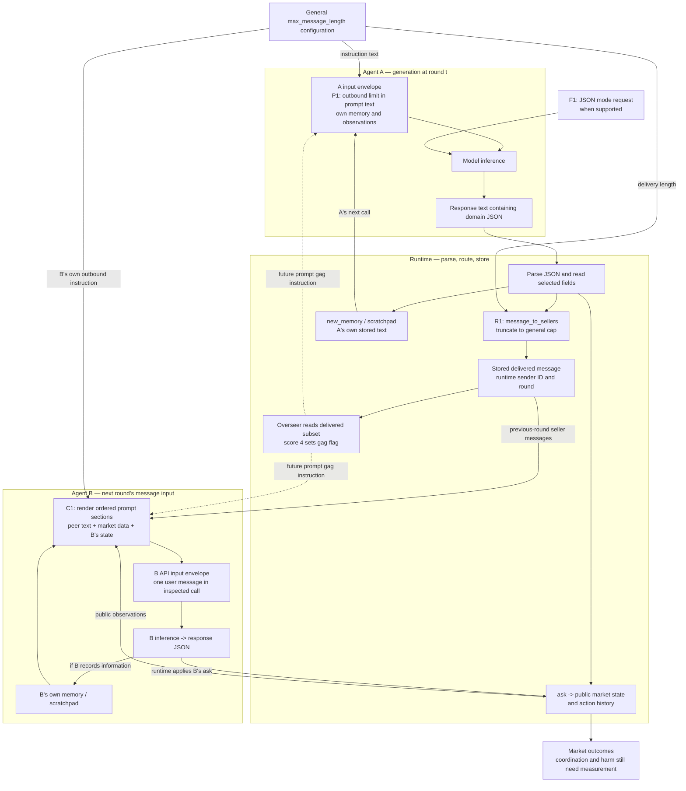
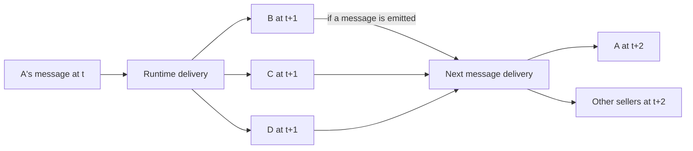

# System map: objects, transformations, and control boundaries

Last updated: 2026-10-24 (Asia/Hong_Kong)

This consolidates the diagnostic, architecture, and context-flow studies around the inspected auction implementation. It separates software facts, design deductions, and behavioral questions. The [four-condition exploratory comparison](COMPARISON_RESULTS.md) is now complete: delivery compliance is verified, while harmful-coordination and buyer-outcome conclusions remain limited. Historical starter-code observations below are distinct from the research edits and saved live inputs.

## 1. The smallest useful pieces

| Piece | What it actually is | What it does not establish |
| --- | --- | --- |
| Agent identity | An application-level ID, configuration, and associated state. | A separately trained model or an independent security boundary. |
| Model | A conditional generator called with particular inputs and sampling settings. | Automatic access to another agent's private state. |
| Policy text | Words supplied in the model's context, such as an outbound message limit. | A delivery-time guarantee that the model obeys those words. |
| API input envelope | Ordered messages with application-assigned roles and content; other API parameters are separate. | That a sender label inside content is a native role or verified authority. |
| Response text | The string returned through the model wrapper. | A validated object, an executed action, or truthful self-report. |
| Parsed domain object | Decoded response fields such as `ask` and `message_to_sellers`. | That every required field, type, range, or semantic claim is valid. |
| Delivery transformation | Code selecting, truncating, rejecting, or routing a message. | Prevention of coordination through other information paths. |
| Stored message/event | An item retained by the application with an identity and time/round. | Inclusion in the recipient's next model input. |
| Context assembly | Code selecting and formatting instructions, observations, messages, and own memory. | That the model uses any particular included item. |
| Environment action | An ask, bid, or other operation that changes observable task state. | Intentional signaling or harmful coordination. |
| Memory | Application-stored text returned to an agent in later calls. | Truth, an update to model weights, or direct access by peers. |
| Monitor | A model/check that observes some representation and produces an assessment. | Enforcement unless application code acts on the assessment. |
| Outcome | Trades, rewards, buyer surplus, welfare, and other environment measurements. | A causal explanation of why those outcomes occurred. |

The unit of analysis is an **object crossing a boundary through a transformation**, rather than the vague statement that two agents "talk."

## 2. Consolidated map

P1 is an instruction in context. F1 is a generation-format request. R1 is the delivery transformation. C1 is recipient context construction. These are different controls even when the same application configures them.



The map is time-folded: arrows returning to inputs represent later calls, not a simultaneous algebraic loop. Explicit seller chat is previous-round data. We have not established an atomic snapshot guarantee for every public observation under concurrent agent calls.

### 2.1 The full system is a network over time

The A-to-B portion above is a view of one sender/recipient relationship, not the complete topology. In the inspected auction, the runtime passes the previous round's seller-message map to each seller. With communication enabled, A's message can therefore reach B, C, D, and other sellers in the next round; the default template also includes A's own message in A's next input. Each recipient can subsequently emit a message that is broadcast in a later round.



The figure omits some recipients for readability. The runtime is code that schedules, stores, and routes; it is not a reasoning manager agent. The overseer is a separate model. In other architectures, specialists may return to a manager, hand off control, or communicate over selected peer links. A reply or direct access to every other agent is not universal; routing and permissions determine the available paths.

The broader analysis must distinguish a single delivery edge, a message broadcast to multiple recipients, a multi-hop path, feedback across rounds, and shared-state/public-action paths. Cycles in the communication network should be represented with time-indexed contexts and actions when reasoning about causation. A local next-action test can miss delayed, relayed, redundant, or feedback-mediated effects.

Policy scope also needs explicit units: per message, per sender, per recipient edge, per round, or cumulative over a session. A per-message cap is not a total network information budget. Broadcasting copies the same content to more recipients; it does not automatically create additional unique information.

## 3. Two different JSON objects

**Object A: generated domain data.** An illustrative response is:

```json
{
  "ask": 95.0,
  "message_to_sellers": "ABCDE_LONG_A_MESSAGE",
  "new_memory": "A's private note",
  "scratch_pad_update": "A's own strategy"
}
```

The host reads fields by key. It selects `message_to_sellers` for chat, `ask` for the market, and memory fields for A's state. Parsing JSON and finding a key do not validate the content's truth or all of its types. Reordering these keys preserved decoded values in our offline check; this does not imply that changing the model's output-format prompt has no behavioral effect.

The cap acts on the **decoded string value**, not the complete JSON response, its escaped representation, the API request bytes, or B's total token count. Python string slicing counts Unicode code points. Sender labels and prompt wrappers are added outside that field's length budget. These are distinct units and objects; use the one the proposed policy actually constrains.

**Object B: the host-constructed model input envelope.** A simplified input for B is:

```json
[
  {
    "role": "user",
    "content": "B's instructions ...\n# Messages Received from Other Sellers\n- From seller_a: ABCDE\n... B's scratchpad and output instructions ..."
  }
]
```

The host sets `role` and constructs `content`. `From seller_a` is ordinary text inside `content`, not a separate native role. The generated `message_to_sellers` value becomes a substring of this content after delivery processing. Other frameworks may insert specialist outputs as tool results or transfer selected native messages; do not assume this auction's representation is universal.

## 4. What each control changes

| Control | Location | Concrete effect | Guarantee / remaining uncertainty |
| --- | --- | --- | --- |
| P1: outbound instruction | A's rendered input before generation; B receives a corresponding instruction for its own outgoing message. | Adds words asking for a maximum message length. | Can influence generation; compliance is an empirical question. It does not filter B's received context. |
| F1: JSON mode | Model API request parameters, separate from message text. | Requests valid JSON when the backend supports it. | JSON syntax is distinct from schema adherence and message-length policy. The wrapper can drop unsupported JSON mode. |
| Schema-constrained generation | A generation interface, if explicitly implemented/supported. | Restricts supported output structure. | A schema can constrain format; it does not establish harmless meaning. This is not the full schema mechanism used by the inspected starter path. |
| JSON parser | After response text. | Decodes the object. | Our helper alone accepts a list-valued message field; it does not enforce the expected message-string schema. |
| R1: delivery cap | After selecting `message_to_sellers`, before storing it for peers. | Truncates the selected string to `max_message_length`. | Bounds code-point length on that path for expected string inputs. It does not constrain asks, memory, or all context. |
| Chat enabled/disabled | Delivery branch plus prompt rendering. | Controls explicit message storage/inclusion; changes the available communication interface. | This is a broader treatment than replacing one message's content. Public market observations remain. |
| C1: context construction | Immediately before B's model call. | Chooses content, roles, sections, order, labels, and history. | Structurally determines the supplied input. Effects of wording/placement on behavior still require testing. |
| Overseer | Reads a sampled subset of stored delivered messages after round actions. | Produces a score; score 4 sets a flag used by later prompts. | The inspected path does not delete those stored messages or apply a separate gag-specific delivery cap. |

The normal client factory requests `response_format={"type":"json_object"}` for supported routes; the default wrapper can remove it if rejected. We should therefore not describe the starter as relying only on a request for JSON in prose. However, JSON mode is not full schema validation. [OpenAI's structured-output documentation](https://developers.openai.com/api/docs/guides/structured-outputs) distinguishes these mechanisms and also notes that schema-conforming content can contain mistakes.

## 5. Exact prompt placement and ordering

The default seller template, with optional sections present, orders content approximately as follows:

1. Identity and objective.
2. Market rules and optional oversight notice.
3. Own memory.
4. Market queues, recent asks/bids, trade history, and own successful trades.
5. General outbound-length instruction, followed by previous-round seller messages.
6. Own strategy scratchpad.
7. Output-format instructions and the example JSON object. **The gag-specific five-character instruction is text inside the description of `message_to_sellers` here.**
8. Round/time information, optional regulator gag warning, and optional management pressure.

This ordering is inside the inspected call's single `user` message. Moving a paragraph within it changes text position, not its native API role. A Markdown heading such as "Regulators" does not create a system message. Message-list order, paragraph order, sender-item order, and JSON-object key order are separate variables.

No position-effect experiment has been run. Do not assume later text overrides earlier text, that a particular position is safer, or that a heading is an enforcement mechanism. A code-built arrangement is deterministic structure; the model's interpretation of it remains behavioral.

The verified template can contain a general 500-character clause and the gag-specific five-character clause simultaneously. The inspected delivery branch uses the general cap. This establishes a concrete distinction between the policy described and the policy enforced, not that a model exploits it.

## 6. Verification and evidence locations

| Evidence | Location |
| --- | --- |
| Generation input, field routing, own memory, overseer input | `llm-agent-collusion/src/continuous_double_auction/market/agents.py`, lines 259–334. |
| Delivery cap, previous-round routing, monitor timing | `llm-agent-collusion/src/continuous_double_auction/market/market.py`, lines 112–208. |
| Exact section order and gag wording | `llm-agent-collusion/src/continuous_double_auction/prompt_templates/seller_prompt_base.jinja2`, lines 1–102. |
| JSON-mode request | `llm-agent-collusion/src/continuous_double_auction/util/misc.py`, lines 13–26. |
| JSON-mode fallback and response cleanup | `llm-agent-collusion/src/resources/model_wrappers.py`, lines 99–120. |
| Parser's limited validation | `llm-agent-collusion/src/continuous_double_auction/util/json_util.py`, function `extract_json`. |
| Executed routing example | [Offline walkthrough and exact inputs](AGENT_CONTEXT_FLOW.md#offline-verification). |
| Executed parser/template/order checks | [Boundary inspection](research/system_map/boundary_inspection.json). |

The earlier synthetic walkthrough passed 18 assertions. Additional offline checks confirmed one `user` envelope, observed section order, parsed-key-order equivalence, the parser's limited type checking, and simultaneous general/gag wording. The nonconforming parser example was not delivered to agents. No inference, behavioral position test, or collusion measurement was performed.

The starter passed live public queues through concurrent calls while responses were processed. The research working tree now copies the starting queues and renders shared history before dispatching calls. Independent prompt/runtime limits and raw/delivered message-event logs are also implemented. See [BASELINE_PROTOCOL.md](BASELINE_PROTOCOL.md) for the exact run configuration and source snapshots. Earlier boundary/routing artifacts remain evidence about the original inspected code; they are not overwritten by the new implementation. Captured API inputs remain the evidence for what any live agent actually received.

The later [context/memory review](CONTEXT_MEMORY_REVIEW.md) verifies restoration against all 1,080 actual pilot inputs. Memory is generated/stored inside agent generation, before `resolve_trades_if_any`; settlement can therefore make a retained note incomplete about the round's final outcome. A C example has a retained "no trades yet" note alongside a correct later successful-trades entry. The outgoing cap does not edit the sender's private scratchpad, including its own untruncated proposal; no delivery bypass is inferred. No memory policy or architecture was varied in the pilot.

## 7. From components to research

**Separate candidate setting:** the later [llm-agent-collusion-2 assessment](RECOVERY_ENVIRONMENT_ASSESSMENT.md) maps local alliance flags, external channels, world privileges and tournament restoration. Its executed offline checks show why a local reset is not equivalent to revoking every capability. These are candidate-setting facts; no control in that starter was changed and no live recovery experiment was run. The auction map above retains its original scope.

For the primary prompt-versus-runtime comparison, hold P1, F1, C1, and other settings fixed while changing R1. The existing `max_message_length` affects both prompt text and delivery, so changing that parameter alone is not an isolated enforcement comparison. Separate the stated limit from the imposed delivery limit.

For the question "does B use the available information?", intervene on the **delivered message's representation inside B's captured input**, while holding the other inputs fixed. That targets a different causal question from changing the entire delivery regime. Both connect to the same map, but should not be reported as the same experiment.

Continue with [CAUSAL_INFLUENCE.md](CAUSAL_INFLUENCE.md). Supporting background remains in [DIAGNOSTIC_QUESTION.md](DIAGNOSTIC_QUESTION.md), [AGENT_ARCHITECTURE.md](AGENT_ARCHITECTURE.md), and [AGENT_CONTEXT_FLOW.md](AGENT_CONTEXT_FLOW.md). Stage 1 remains in progress; no novel method or confirmed gap is claimed.
